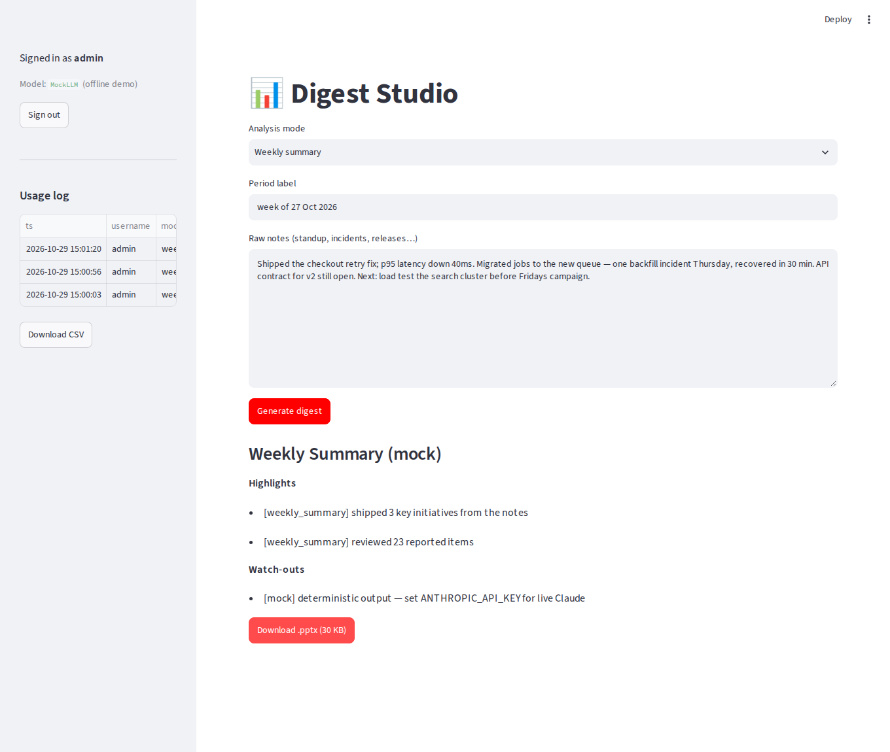
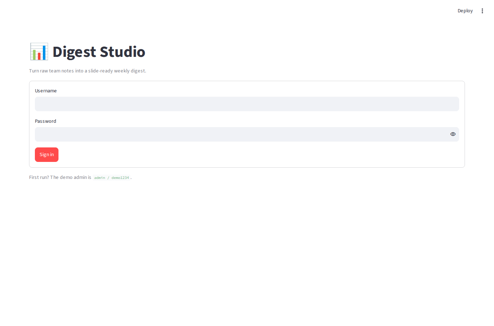

# Digest Studio — ai-report-generator

**Turn raw team notes into a slide-ready .pptx digest with an LLM.** Paste standup /
incident / release notes, pick an analysis mode, get a structured summary **and a
branded PowerPoint deck** — behind a login, with every generation logged and
CSV-exportable.

The LLM layer is a one-method interface with **two providers**: Claude (Anthropic
Messages API) and a deterministic **MockLLM** — so the whole app runs and is tested
offline, no API key required.



## Quickstart

```bash
python3 -m venv .venv && .venv/bin/pip install -r requirements.txt
.venv/bin/streamlit run app.py
# sign in: admin / demo1234   (created on first run, change via ADMIN_USER/ADMIN_PASSWORD)
```

Runs on the mock provider by default. To use Claude: `export ANTHROPIC_API_KEY=…`
(optional `ANTHROPIC_MODEL=…`).

```bash
.venv/bin/python -m pytest -q   # 17 tests, MockLLM — no network
```

## The three analysis modes

| Mode | What it asks for |
|---|---|
| **Weekly summary** | neutral digest of what shipped / what's in flight |
| **Risk flags** | only risks, incidents and blockers, each with impact |
| **Next week** | forward-looking priorities and concrete actions |

All three share **one strict JSON contract** (`title`, `period`, `sections[heading,
bullets]`) that a validating parser enforces — markdown fences are tolerated, prose or
empty sections are rejected with a clean error in the UI.

## Architecture

```
notes ── core/modes.py ──▶ LLM interface ── AnthropicLLM (Claude)
              │                 └─────────── MockLLM (deterministic, offline)
              ▼
        validated digest ── core/deck.py ──▶ branded 16:9 .pptx (python-pptx)
```

| Module | Responsibility |
|---|---|
| `core/llm.py` | `complete(system, prompt)` interface; provider chosen by env, mock fallback when no key. |
| `core/modes.py` | prompt builders + the trust boundary: JSON contract validation. |
| `core/deck.py` | digest → slides (title + one section per block, brand bar, 16:9). |
| `core/auth.py` | scrypt password hashing, first-run default admin. |
| `core/usage.py` | per-generation log (user, mode, sizes, duration) → CSV. |
| `app.py` | thin Streamlit layer: login, form, preview, download, usage sidebar. |

## Rebranding & re-targeting

- **Rebrand:** point `PPTX_TEMPLATE` at your .pptx, or edit `core/deck.py` brand colours;
  `python make_template.py` regenerates the stock template.
- **New domain:** the prompts in `core/modes.py` are the only domain-specific code —
  swap the texts to retarget from engineering digests to any weekly-report niche.

## Screens

| Login gate | Output & deck download |
|---|---|
|  |  |

## Deploy

`Procfile` and `railway.json` included:
`streamlit run app.py --server.port $PORT --server.address 0.0.0.0 --server.headless true`.
Persist `USAGE_DB` (SQLite file) on a volume; set `ANTHROPIC_API_KEY`.

_Licence: MIT._
